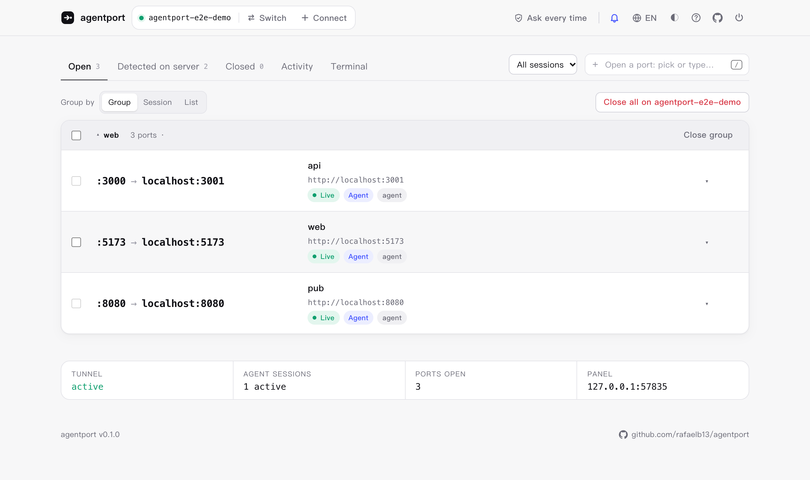
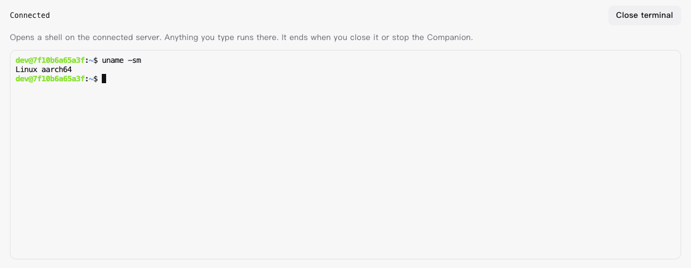

# agentport

English | [Português (Brasil)](README.pt-BR.md) | [Español](README.es.md) | [繁體中文](README.zh-Hant.md)

agentport lets a coding agent running on an SSH server use the ports of your
machine, with your approval. The agent can see what is listening on the server
and ask for a port to be opened on your machine, through the SSH connection you
already have. You decide what is opened and when it is closed.

> **Work in progress.** The base works today: the Companion, the reverse SSH
> tunnel, the MCP server, the automatic registration in the agents, the
> installers, the verifiable releases, the port tools with your approval, the
> panel (groups, close-all, the Detected tab, a web terminal to the server) and
> the recovery of forwards after a Companion restart. The Windows host is
> compiled in CI but has not run on a real Windows machine yet. The automatic
> start on connect and the end-to-end validation for `v0.1.0` are still open.

<picture>
  <source media="(prefers-color-scheme: dark)" srcset="docs/images/panel-dark.png">
  
</picture>

**Contents**

- [Installation](#installation)
  - [Install script](#install-script)
- [What it is](#what-it-is)
- [How it works](#how-it-works)
- [Requirements](#requirements)
- [Server setup](#server-setup)
- [Auto-start](#auto-start)
- [Everyday use](#everyday-use)
- [The panel](#the-panel)
- [Terminal](#terminal)
- [MCP tools](#mcp-tools)
- [Multiple agent sessions](#multiple-agent-sessions)
- [Busy ports on the host](#busy-ports-on-the-host)
- [Standalone mode](#standalone-mode)
- [Languages](#languages)
- [Security](#security)
- [Updating](#updating)
- [Uninstalling](#uninstalling)
- [Troubleshooting](#troubleshooting)
- [Development](#development)
- [Credits](#credits)
- [License](#license)

## Installation

The Windows host is compiled in CI, but it has not run on a real Windows machine yet.

### Install script

On macOS or Linux:

```bash
curl -fsSL https://raw.githubusercontent.com/RafaelB13/agentport/main/scripts/install.sh | sh
```

Pick a version or a directory:

```bash
curl -fsSL https://raw.githubusercontent.com/RafaelB13/agentport/main/scripts/install.sh | sh -s -- --version vX.Y.Z --install-dir "$HOME/.local/bin"
```

On Windows, in PowerShell:

```powershell
irm https://raw.githubusercontent.com/RafaelB13/agentport/main/scripts/install.ps1 | iex
```

To pass a version, download the script and run it with `-Version`:

```powershell
.\install.ps1 -Version vX.Y.Z
```

The scripts detect your platform, read the latest release, verify it (see
below), and compare it with the installed version. They download only when the
release is newer, so running them again is safe. Options:

| Option | Shell | PowerShell | Environment variable |
| --- | --- | --- | --- |
| Version | `--version vX.Y.Z` | `-Version vX.Y.Z` | `AGENTPORT_VERSION` |
| Install directory | `--install-dir PATH` | `-InstallDir PATH` | `AGENTPORT_INSTALL_DIR` |
| Repository | | | `AGENTPORT_REPOSITORY` |
| Skip the attestation check | | | `AGENTPORT_SKIP_ATTESTATION=1` |
| Language | | | `AGENTPORT_LANG` |

The Windows default install directory is `%LOCALAPPDATA%\Programs\agentport\bin`.
Releases are also listed on the
[GitHub Releases page](https://github.com/RafaelB13/agentport/releases).

Two optional settings, for the shell script only:

- `GITHUB_TOKEN`: a token with read access to the repository. Set it while the
  repository is private. The script then downloads the release assets through
  the GitHub API, and the token is sent only to `api.github.com`.
- `AGENTPORT_DRY_RUN=1`: prints where the archive, the checksums, the attestation
  and the install directory are, then exits without downloading or installing.

The script checks every download against the release's SHA-256 checksums and
stops on a mismatch or on a missing entry. To read it before running it,
download it first:

```bash
curl -fsSLO https://raw.githubusercontent.com/RafaelB13/agentport/main/scripts/install.sh
less install.sh
sh install.sh
```

### Homebrew

> **Planned.** The release workflow already renders the formula, but the tap
> `rafaelb13/homebrew-tap` is not published yet, so the commands below do not
> work yet. Use the install script or build from source until the tap exists.

Once the tap is published:

```bash
brew install rafaelb13/tap/agentport
agentport version
brew upgrade agentport
brew uninstall agentport
```

Homebrew owns the install. If you installed with Homebrew, `agentport upgrade`
does not replace the binary: it prints `agentport was installed with Homebrew.
Run: brew upgrade agentport` and exits with status 0. Autostart does not need
`brew services`: the Companion starts with `agentport companion autostart`
(see [Auto-start](#auto-start)).

### From source

```bash
git clone https://github.com/RafaelB13/agentport.git
cd agentport
go build -o agentport ./cmd/agentport
```

Put the resulting `agentport` on your `PATH`. A binary built from source has no
release version, so `agentport version` does not show a release number and the
upgrade check does not apply to it.

### Verify a release

Every release publishes `checksums.txt`, signed with
[cosign](https://github.com/sigstore/cosign) (keyless, bound to the release
workflow's identity), and a build attestation from GitHub. Each archive has a
SHA-256 entry, and the attestation covers the archives, the SBOMs and the
checksums. To verify by hand, download the release's `checksums.txt`,
`checksums.txt.bundle` and `attestation.jsonl`:

```bash
VERSION=vX.Y.Z
# The identity needs the exact tag of the release, so a run from another branch is not accepted.
IDENTITY="https://github.com/RafaelB13/agentport/.github/workflows/release.yml@refs/tags/${VERSION}"

cosign verify-blob \
  --bundle checksums.txt.bundle \
  --certificate-identity "$IDENTITY" \
  --certificate-oidc-issuer https://token.actions.githubusercontent.com \
  checksums.txt

# Linux
sha256sum --check --ignore-missing checksums.txt
# macOS (it has neither sha256sum nor --ignore-missing)
ARCH=$(uname -m | sed s/x86_64/amd64/)
grep " agentport_${VERSION}_darwin_${ARCH}.tar.gz$" checksums.txt | shasum -a 256 --check

gh attestation verify "agentport_${VERSION}_linux_amd64.tar.gz" \
  --repo RafaelB13/agentport \
  --cert-identity "$IDENTITY"
```

`gh attestation verify` without `--bundle` asks GitHub and needs `gh auth login`.
To verify without logging in, add `--bundle attestation.jsonl`.

**Automatic check.** From `v0.7.1-rc.1` on, the installers and `agentport upgrade`
confirm, besides the SHA-256, that the file was produced by this repository's
release workflow for the tag being installed. If that check fails, the install
is refused. The install script uses `gh attestation verify` when `gh` is
installed and falls back to the GitHub attestations API otherwise. `agentport
upgrade` uses the API. Releases before `v0.7.1-rc.1` have no attestation; they
are installed with the SHA-256 check only, and the installer says so.

If the attestation API is down or rate-limited, the install is refused rather
than going on without the check. To install with the SHA-256 check only, set
`AGENTPORT_SKIP_ATTESTATION=1`. `agentport setup` and `agentport upgrade` apply
the same setting to the binaries they send to servers.

## What it is

agentport has three parts:

- **The Companion**, a background process on your machine. It keeps a local
  bridge on `127.0.0.1`, holds a reverse SSH tunnel to each server you paired,
  and reconnects with a backoff of 1 to 30 seconds when the link drops.
- **The MCP server** (`agentport mcp`), which the coding agent starts on the
  server through `stdio`. agentport registers it in the agents it finds there.
- **The panel**, a page on your machine where you approve, see, group and close
  the ports the agent asked for, and open a terminal to the server.

You can set up a server, connect to it with `ssh`, use the agent with the
`agentport_status` tool, which reports the tunnel and whether a newer release
exists, and ask the agent to open ports on your machine, with your approval.

> **Screenshot placeholder.** Screenshots of the panel will be added here.

agentport is a fork of [AgentClip](https://github.com/wendellrocha/agentclip),
which sends the other way (from your machine to the server). See
[Credits](#credits).

## How it works

```text
HOST (your machine)                          SERVER (reached over SSH)

 Companion                                    agent (Claude Code, Codex, ...)
   local bridge on 127.0.0.1                    |  stdio, started by the agent
        ^                                       v
        |                                      agentport mcp
        +---- reverse SSH tunnel (ssh -R) ------+
              one connection per server
```

1. `agentport setup` installs agentport on the server, registers its MCP server
   in the agents it finds there, saves a **profile** on your machine (the server,
   a pairing token and a remote port) and starts the Companion.
2. The Companion opens `ssh` to the server with a reverse tunnel. The tunnel
   carries the bridge to the server, so `agentport mcp` can reach it on a port
   of the server's loopback interface.
3. The agent starts `agentport mcp` on the server through `stdio`. The MCP server
   talks to the bridge with a session token, through the tunnel.
4. The port tools ask the Companion to open a port, and you approve it. The
   Companion opens it through the same SSH connection (`ssh -O forward -L`, with
   ControlMaster on macOS and Linux; on Windows, one `ssh` process per forward),
   so the port reaches `127.0.0.1` of your machine only. Nothing is listening on
   your network.

Each server has its own profile and its own Companion, so two servers never
share a token or a tunnel.

## Requirements

**Your machine (host)**

- macOS (Apple silicon or Intel), Linux (amd64 or arm64) or Windows (amd64).
  The Windows installer, the Companion and the forwards are compiled in CI, but
  they have not run yet on a real Windows machine. The server terminal is not
  available on Windows.
- OpenSSH client (`ssh`) on your `PATH`. The Companion uses it for the tunnel,
  so it reads your `~/.ssh/config`, keys and ssh-agent as usual.
- Go 1.27 or newer, only if you build from source.

**The server**

- Linux or macOS, amd64 or arm64, with an SSH server you can log in to. The
  first `setup` may ask for the password once; after that, a key is used.
- A POSIX shell, because `setup` runs a short fixed set of commands over SSH.
- `AllowTcpForwarding yes` in the server's SSH configuration (`sshd_config`).
  The reverse tunnel uses `ssh -R`, which the server refuses when forwarding is
  set to `no`. OpenSSH's default is `yes`; check the effective value with
  `sshd -T` on the server.
- At least one supported coding agent installed (see the table below). agentport
  does not install agents.

**Supported agents (harnesses)**

agentport integrates with the *harness*, the program that runs the agent and
calls its tools, not with the model it uses. `setup`, `pair` and `connect`
detect the harnesses that are already installed and configure only those.

| Harness | Status | Integration |
| --- | --- | --- |
| Claude Code | Supported | Detected and configured automatically when installed |
| Codex | Supported | Detected and configured automatically when installed |
| Gemini CLI | Supported | Detected and configured automatically when installed |
| AGY / Antigravity CLI | Supported | agentport creates or updates the global MCP entry |
| OpenCode | Supported | agentport creates or updates the global MCP entry |
| Pi Coding Agent | Supported | agentport installs a global extension |
| Other MCP client | Manual | Point it at `agentport mcp` and set the profile variables yourself |

DeepSeek and MiMo are models, not harnesses: use them through a supported
harness such as Pi or OpenCode.

## Server setup

`agentport setup` configures a server in one command:

```bash
agentport setup devbox --profile m2
ssh devbox
codex
```

Here `devbox` is an SSH alias from your `~/.ssh/config`. Then ask the agent
to check the link: "Check the agentport status." It calls `agentport_status`.

The synopsis of `setup`:

```text
agentport setup <ssh-destination> [--profile NAME] [--agent all|codex|claude|gemini|agy|opencode|pi] [--version vX.Y.Z] [--remote-port 39123] [--skip-agent] [--skip-install] [--no-start]
```

What `setup` does, in order:

1. **Checks SSH.** It first tries a key login without interaction. If that
   works, your existing SSH setup is kept as it is.
2. **Creates a dedicated key if needed.** If the server accepts only a
   password, `setup` creates an Ed25519 key used only by agentport, asks for the
   password once to add the key to the server's `authorized_keys`, and uses that
   key for the later tunnels. The key lives in your user config directory
   (`agentport/keys/`) with private permissions.
3. **Installs the server binary** into `~/.local/bin/agentport`. This machine
   downloads and verifies the binary for the server's platform (it reads the
   server's `uname`) and sends it over SSH. A server that already has the same or
   a newer version is not changed. Skip this with `--skip-install`.
4. **Registers agentport in the agents** found on the server, unless
   `--skip-agent` is given. `--agent` limits it to one harness.
5. **Saves the profile** on your machine, with the destination, the pairing
   token and the remote port. Your profiles are in
   `<user config directory>/agentport/profiles/` (on macOS,
   `~/Library/Application Support/agentport/profiles/`). The file holds the
   pairing token, so keep it private.
6. **Starts the Companion**, unless `--no-start` is given.

Running `setup` again for the same profile issues a new pairing token and stops
the Companion that was running for it.

### Options

| Option | Meaning |
| --- | --- |
| `--profile NAME` | Local name of the pairing. Defaults to a name derived from the destination. |
| `--agent NAME` | Limit the setup to one harness: `codex`, `claude`, `gemini`, `agy`, `opencode`, `pi`, or `all` (default). |
| `--version vX.Y.Z` | Release to install on the server. |
| `--remote-port N` | Loopback port of the server used by the reverse tunnel. Default `39123`. |
| `--skip-agent` | Do not register the MCP integration on the server. |
| `--skip-install` | Do not install or update the binary on the server. |
| `--no-start` | Finish without starting the Companion. |

### Server destinations

The destination is what you would give to `ssh`: an alias from `~/.ssh/config`,
a host name, or `user@host`. Port, key and jump host live in the SSH config, so
use an alias for a server that needs them:

```text
# ~/.ssh/config
Host devbox
  HostName 10.0.0.12
  User rafael
  Port 2222
  IdentityFile ~/.ssh/id_ed25519
  ProxyJump jumphost
```

**Planned:** `setup` will take the port, key and jump host as flags
(`-p`, `-i`, `-J`), and IPv6 literals with a port (`user@[2001:db8::12]:2222`).
Until then, use an alias.

## Auto-start

The Companion runs on your machine, so it has to be running for the tunnel to
exist. There are two ways to have it start by itself.

**When you log in (available now).** `agentport companion autostart enable m2`
installs the system's own login mechanism: a LaunchAgent in
`~/Library/LaunchAgents` on macOS, a systemd user unit in
`~/.config/systemd/user` on Linux, and a Task Scheduler task that runs at logon on
Windows. The service runs `agentport companion serve m2` and restarts it if it
fails. It does not start a second Companion when one is already running.

```bash
agentport companion autostart enable m2
agentport companion autostart status m2
agentport companion autostart disable m2
```

`disable` stops the Companion that the service started. A Companion you started
yourself keeps running.

**When you connect to the server (planned, F5).** `setup` will add a block to
your `~/.ssh/config`, after asking you, so that connecting to the server starts
the Companion if it is not running:

```text
# agentport: profile m2
Match host 10.0.0.12 user rafael
  PermitLocalCommand yes
  LocalCommand agentport companion ensure m2
```

The block will be delimited by its `# agentport: profile` comment, so removing
those lines removes it. Until it lands, there is no block to remove.

**If the server restarts** while the Companion keeps running on your machine,
the Companion reconnects the tunnel by itself, with a backoff of 1 to 30 seconds.
The same profile and remote port are used again.

## Everyday use

Connect to the server as usual and start the agent:

```bash
ssh devbox
codex
```

Check the link at any time by asking the agent:

> Check the agentport status.

The agent calls `agentport_status`, which tells you whether the tunnel to your
Companion is connected and whether a newer stable release is available. To see
the same thing on your machine:

```bash
agentport companion status m2
```

You can ask:

> Map the ports of this project and open the app on localhost.

The agent lists the server's listening ports, then asks to open the ones it
needs, with a reason for each. Each request appears in the panel as one batch
request, even when it has many ports, so you approve or refuse them together or
one at a time. Approved ports open on `127.0.0.1` of your machine, and the agent
tells you the local URL. If the local port is busy, agentport uses the next free
one and says so.

## The panel

The panel is a page on your machine, served on `127.0.0.1` and protected by a
token. It shows:

- **Requests from the agent** at the top: port, reason, command, approve or
  refuse, and how long the approval lasts (this session, one hour, or always).
  A batch request becomes one card with checkboxes and "Approve all".
- **Open ports** as `:remote -> localhost:local`, with the name, the command,
  live traffic, open in a new tab, pin, details, edit and close. Closing asks
  for confirmation and shows which agent sessions will be told.
- **Grouping and bulk close**: group by request, by agent session, or as a flat
  list; select several ports; close a group or the selection with one
  confirmation.
- **Switching servers** with open ports asks whether to close them, keep them,
  or cancel, with an option to remember the choice.
- **Closed ports**, with time and who closed them, and **reopen**, which uses
  the same configuration or proposes a free local port if the old one is taken.
- **Detected ports** on the server and a menu to open one by hand (shortcut `/`).
- **Process details** on demand: PID, user, CPU, memory, directory, parent
  process, container, command line, port health, and the agent's reason.
- **Activity**, notifications, shortcuts, and a **top bar** with the current
  server, a server switcher, the web terminal, the approval policy, language,
  theme (system, light, dark), help, and end session.
- **Web terminal**: a terminal to the server that opens from the panel. It uses
  the SSH connection of the profile and stays on `127.0.0.1` with the panel's
  token (see [Terminal](#terminal)).
- **Connect to a server**: planned, with suggestions found on your machine (see
  [Standalone mode](#standalone-mode)).

The panel is opened with `agentport companion open m2`. The tunnel state
(`Connected` or `Disconnected`), the last error and a notice when a newer stable
release exists are shown there too, and `agentport companion stop m2` stops the
Companion. The panel does not transfer files.

## Terminal

The panel has a **Terminal** tab that opens a shell on the connected server, so you can run a quick command without leaving the browser. It reuses the tunnel's SSH connection (no second login), is served only to the panel on `127.0.0.1`, and accepts connections only from the panel's own page. Up to four terminals can be open at once. Closing the tab's terminal, or stopping the Companion, ends the SSH session on the server. Terminal contents are never written to logs. On Windows the terminal is not available in this version.



## MCP tools

The agent sees these tools through the MCP server on the server.

| Tool | Input | Returns |
| --- | --- | --- |
| `agentport_status` | none | **Available now.** The tunnel state, the agentport version, and whether a newer stable release exists (then it recommends `agentport upgrade`). |
| `ports_list` | `include_system?`, `only_user?` | Listening TCP ports on the server: port, bind address, protocol, PID, process, a short command line, and whether a forward already exists. |
| `ports_forward` | `reason`, `group?`, `ports[]` of `{remote_port, label?, path?}` | Asks for your approval as one batch request. For each port it returns the state (`active`, `pending_approval`, `denied`, `skipped`), the local port actually used, and the URL with `path`. It waits up to 2 minutes; if you have not answered, it returns `pending_approval`, and the agent can check `forwards_list` later. |
| `ports_unforward` | `ports[]` or `all` | Closes the forwards of this session. It never closes a port that belongs to another session. |
| `forwards_list` | none | Active forwards with their origin (agent, automatic or manual), the time active, and bytes. Forwards of other sessions are marked as such and cannot be closed from this session. |

The agent never chooses your local port, and no tool lets it stop a process on
your machine. Stopping a process is your decision, taken in the panel.

If the Companion is not running when a tool is called, the tool answers that the
Companion is offline and tells the agent to run `agentport companion start <profile>`,
which the agent passes on to you.

## Multiple agent sessions

One Companion serves each server. Each agent session on that
server (for example two Claude Code sessions in different projects, or Claude
Code and Codex) runs its own `agentport mcp`, and all of them talk to the same
Companion. Each session is identified by its agent, its PID, its project folder
and the time it started.

- Only the Companion chooses local ports, one request at a time, so two
  sessions never get the same local port.
- If two sessions ask for the same remote port, it is opened once. Both get the
  same URL, and both are its owners. The port closes when no owner needs it, or
  when you close it.
- `ports_unforward` removes only the calling session from the owners of its
  ports. A port that another session still owns stays open.
- When a session ends, the ports that only it owned are marked "session ended",
  and they close after 20 minutes unless you pinned them. If the agent comes
  back to the same folder within that time, it gets them back.
- If the Companion restarts or the tunnel drops, the forwards that were open are
  reclaimed when the link returns, so the agent sessions keep their ports and do
  not have to ask again.

## Busy ports on the host

When the local port you asked for is already used on your machine, the forward
does not fail. The Companion uses the next free port above it, and the message
names the program that holds the busy one, for example
`local port 3000 is busy: node (pid 1234)`. If the owner cannot be identified,
the message says `another program`. The panel offers the choices below, which
the Companion checks again before it opens the port (the owner is identified by
`internal/hostport`).

| Who holds the port | What the dialog offers |
| --- | --- |
| A process of yours (node, vite, python) | Use another port, or stop the process: SIGTERM, then SIGKILL after 5 seconds (`taskkill` on Windows). |
| A service that restarts itself (`brew services`, LaunchAgent, systemd user) | Use another port, or stop the service with the right command (for example `brew services stop php`), shown before it runs. |
| A Docker container | Use another port, or `docker stop <container>`. Never the Docker daemon. |
| Another user or the system | Use another port. Stopping is disabled and explained. The panel never asks for an administrator password. |

After a stop, the Companion checks the port again. If it is still busy, it uses
the alternative port and records that in the activity.

## Standalone mode

**Planned.** `agentport open` will open the panel without a profile, with a
screen to connect to a server. It will suggest connections found on your machine,
with nothing sent anywhere:

- the hosts in `~/.ssh/config` and their `Include` files (wildcard entries such
  as `Host *.corp` are skipped), with user, port, key and jump host resolved by
  `ssh -G <alias>`;
- the Remote-SSH configuration of VS Code;
- `ssh` sessions open right now, marked "connected now";
- on Windows, the saved PuTTY sessions.

Your terminal history (`~/.zsh_history`, `~/.bash_history`) is used only if you
tick an option for that search. `known_hosts` is not a source, because its names
are usually hashed. Each suggestion has **Test** (`ssh -o BatchMode=yes`, to see
whether the key works, whether it asks for a password, and whether agentport is
installed) and **Configure** (the same flow as `setup`). You can also type
`user@ip`.

## Languages

agentport has four languages: English (default), Português (Brasil), Español and
繁體中文 (Traditional Chinese, as used in Taiwan).

The command line, `help`, the installers and the Companion choose their language
from the environment, in this order:

1. `AGENTPORT_LANG`
2. `LC_ALL`
3. `LC_MESSAGES`
4. `LANG`

The first one that is set decides, as it does for the C library. `pt`, `pt_BR`,
`pt_PT` and similar values give Português (Brasil); `es` and `es_*` give Español;
`zh_TW`, `zh_HK`, `zh_MO` and `zh-Hant` give 繁體中文. `C`, `POSIX` and anything
else, including `zh_CN` and `zh-Hans`, give English. So `LANG=pt_BR.UTF-8
agentport help` prints Portuguese, and `AGENTPORT_LANG=en` forces English.

The Companion page takes `?lang=pt-BR` in the address first, then the browser's
preferred language, then the language the Companion process detected as above,
then English.

The command line and the Companion have catalogs for Português (Brasil), Español
and 繁體中文. The installers have English and Português (Brasil) messages. Technical
error messages stay in English on purpose, so they can be searched for. Command
names, paths and process names are not translated.

## Security

- The bridge listens only on `127.0.0.1`. The server reaches it only through the
  SSH tunnel that the Companion opened.
- The server is part of your trust base. An agent on the server can reach the
  bridge only with the session token that the Companion registers for it.
- The pairing token is stored in your profile file. Do not put profiles or
  tokens in files that go into a project repository.
- The Companion page is on `127.0.0.1` and needs a token that is in its URL.
  Do not share that URL: it is a view on your Companion.
- Releases are built by one workflow, with a SHA-256 checksum, a cosign
  signature, a build attestation, and a `govulncheck` scan of the binaries.
  See [Verify a release](#verify-a-release).

For the port tools and the panel:

- Forwards bind only to `127.0.0.1` on your machine. There is no option to bind
  to `0.0.0.0` in version 1.
- The target of a forward is always `127.0.0.1:<port>` on the server, so the
  tunnel cannot be used to reach other hosts on the server's network.
- You approve every port the agent asks for, unless you choose "always" for it.
- Blocked ports (22, 2375, 2376) and a limit on simultaneous forwards per profile.
- Stopping a process on your machine is possible only from the panel, with
  confirmation, and never with administrator privileges. It is not an MCP tool.

## Updating

`agentport upgrade` downloads the latest stable release for this machine, checks its
SHA-256 and its attestation, and replaces this executable. It then updates every
saved server, in the order below.

1. This machine downloads and verifies the binary (the slowest step; the output
   says so).
2. Each server is updated. A failure on one server does not stop the others, and
   the summary names each profile that failed.
3. Only then are the running Companions stopped, the local executable is
   replaced, and those Companions are started again. The local replacement is
   last because it is the only step that is hard to undo.

If this machine already runs the latest release, nothing is downloaded or
replaced here; only servers that are behind are updated.

**With Homebrew**, the binary belongs to the Homebrew keg, so `agentport upgrade`
does not replace it. It prints `agentport was installed with Homebrew. Run: brew
upgrade agentport` and then updates every saved server to the version of this
binary, the same as on any install. To move this machine to a newer release, run
`brew upgrade agentport`; the next `agentport upgrade` brings the servers to that
version.

Set `AGENTPORT_SKIP_ATTESTATION=1` only if you accept the SHA-256 check alone.

The Companion checks for a newer stable release at start and at most once every
24 hours, and shares that check between profiles. A newer release is shown in
the Companion page and by `agentport_status`.

## Uninstalling

1. **Stop autostart and the Companion** for each profile:

   ```bash
   agentport companion autostart disable m2
   agentport companion stop m2
   ```

2. **Remove the agentport entry from each harness** on the server:

   ```bash
   agentport uninstall m2 --agent claude
   ```

   Repeat for every harness you configured. This removes only agentport's entry
   or extension. It does not remove the agent itself.

3. **Remove the binary** from the server, if no other profile uses it:

   ```bash
   ssh devbox 'rm -f ~/.local/bin/agentport'
   ```

4. **Remove the local files**: the profile in
   `<user config directory>/agentport/profiles/m2.json`, the dedicated key in
   `<user config directory>/agentport/keys/` (if one was created), and the logs in
   `<user cache directory>/agentport/logs/`.

5. **Remove the binary** on your machine:
   - Homebrew: `brew uninstall agentport`.
   - Install script or source: delete the `agentport` file from its directory
     (by default `~/.local/bin` on macOS and Linux, and
     `%LOCALAPPDATA%\Programs\agentport\bin` on Windows).

**Planned:** `uninstall` will also remove the `~/.ssh/config` block that
`setup` adds, and a command will delete a profile.

## Troubleshooting

**The Companion is not running.** Start it with `agentport companion start m2`,
or enable [autostart](#auto-start). `agentport companion status m2` says whether
it runs and why the tunnel is down.

**The tunnel keeps disconnecting.** Check the log path with `agentport logs m2`,
or export it with `agentport logs m2 --export ./agentport-m2.log`. To record
tunnel events while you reproduce the problem:

```bash
agentport companion stop m2
agentport companion start m2 --verbose
```

Verbose mode logs tunnel events and errors. It never logs tokens or content.

**`setup` keeps asking for the password.** The server is not accepting public
key logins for your user, or its `~/.ssh/authorized_keys` cannot be written.
Check that key login works with plain `ssh` first; `setup` can add its
dedicated key only when the password works once.

**"could not verify the build attestation".** The attestation API could not be
reached, or the release has none. Check your network, or install `gh` and retry.
Set `AGENTPORT_SKIP_ATTESTATION=1` only if you accept the SHA-256 check alone.

**"SSH destination must not start with a dash".** The destination looks like a
flag. Give a host, an alias, or `user@host`.

**`upgrade` says agentport was installed with Homebrew.** Run `brew upgrade
agentport`, as the message says.

**`agentport doctor` says the bridge is unavailable.** Start the Companion of a
profile. `doctor` checks only the local bridge; `companion status` also reports
the tunnel.

## Development

Build, tests, the release process and the message catalogs are in
[DEVELOPMENT.md](DEVELOPMENT.md). Contribution rules are in
[CONTRIBUTING.md](CONTRIBUTING.md), and the security policy is in
[SECURITY.md](SECURITY.md). The command reference is [COMMANDS.md](COMMANDS.md).

**End-to-end harness.** `test/e2e` starts a disposable `sshd` in Docker and checks,
against it, the forwards over a real ControlMaster, the port conflicts and the port
scanner inside Linux. It needs Docker running and does not touch your `~/.ssh`:

```bash
test/e2e/run.sh
go test -tags e2e -v -count=1 ./test/e2e/
```

A plain `go test ./...` does not run it.

**Planned (F7):** the same harness will drive `setup` and the port tools end to end
once they are merged.

## Credits

agentport started as a fork of [AgentClip](https://github.com/wendellrocha/agentclip),
by [Wendell Rocha](https://github.com/wendellrocha), distributed under the MIT
license. We reuse the Companion base, the reverse SSH tunnel, the MCP server over
stdio, the automatic registration in the agents, and the verifiable release
pipeline. Thanks to the original project. 💙

## License

Distributed under the [MIT license](LICENSE). The license keeps the copyright of
the original AgentClip project, together with the copyright of agentport.
